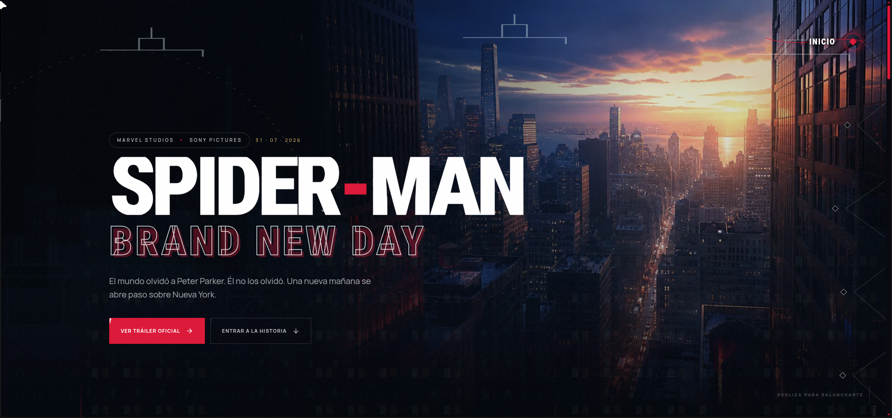

# Spider-Man: Brand New Day (Landing demo)

Fan-made interactive landing page inspired by _Spider-Man: Brand New Day_. Built with Vite, React 19, Tailwind CSS 4 and Motion.

**Live demo:** <https://spiderman-demo-midu.pages.dev/>

[](https://spiderman-demo-midu.pages.dev/)

## Requirements

- Node.js 22+
- [pnpm](https://pnpm.io) 11+

## Running locally

```bash
pnpm install
pnpm dev
```

Open <http://localhost:5173> in the browser.

## Other commands

| Command             | What it does                           |
| ------------------- | -------------------------------------- |
| `pnpm build`        | Type-check + production build (`dist`) |
| `pnpm preview`      | Serve the production build             |
| `pnpm lint`         | ESLint                                 |
| `pnpm format:check` | Check formatting with Prettier         |
| `pnpm doctor`       | React Doctor diagnostics               |
